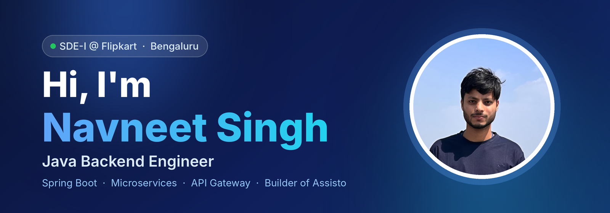

  

  
  
  
  
  

 

<table align="center">
  <tr>
    <td align="center" width="200"><h2>2+</h2>Years of Experience</td>
    <td align="center" width="200"><h2>90K+</h2>Train searches in 12 hrs</td>
    <td align="center" width="200"><h2>25+</h2>Production REST APIs</td>
    <td align="center" width="200"><h2>~30%</h2>API latency reduction</td>
  </tr>
</table>

 

<h2 align="center">👨‍💻 About Me</h2>

Java Backend Developer with <b>2+ years</b> of experience building high-volume REST APIs and microservices with <b>Java, Spring Boot, Hibernate/JPA and SQL</b>. 
At <b>Flipkart</b>, I work in the <b>MAPI (Mobile API) team</b> as the primary backend owner of the <b>Travel platform services</b> (Train search &amp; PNR status, Flight Status). 
Previously at <b>Tech Mahindra</b>, I delivered <b>25+ production APIs</b> for a US healthcare client and cut API latency by <b>~30%</b> through SQL and index tuning. 
Outside work, I built and launched <a href="https://asisto.in"><b>Assisto</b></a>, a full-stack verified-helper booking platform that is live in production.

---

<h2 align="center">💼 Experience</h2>

### 🏢 Flipkart · Software Development Engineer - I
📅 March 2026 – Present &nbsp;·&nbsp; 📍 Bengaluru, India

- Part of the **MAPI (Mobile API)** team, building Flipkart's API gateway layer for routing, orchestration, aggregation and transformation of high-volume mobile requests.
- Primary backend owner of the **Travel platform services**: design, development, releases, production support and Grafana monitoring, end to end.
- Independently designed and built the **Train integration** (search + real-time PNR status): handled **90K+ searches in 12 hours** and serves **4K+ PNR checks per day**.
- Built the **Flight Status** integration on Cirium APIs with request validation, response transformation and fault-tolerant error handling.
- Integrated partner APIs (**Cleartrip, Ixigo, Cirium**) and contributed to the **Rome-to-Asgard** migration of API flows.
- Optimized external REST integrations, troubleshot production issues, and contributed to observability (Cosmos dashboards) and pod-level performance tuning.

### 🏢 Tech Mahindra · Associate Software Engineer
📅 Sept 2024 – March 2026 &nbsp;·&nbsp; 📍 Bengaluru, India

- Delivered **25+ REST APIs** for **Blue Shield of California** (Audit, Contact Management, Role Types, Eligibility) on a greenfield microservices application.
- Cut API response times by **~30%** by optimizing SQL queries and indexes on 100K+ record tables (JPA/Hibernate).
- Implemented **JWT authentication and RBAC** with Spring Security across microservices.
- Containerized services with **Docker and Kubernetes**; contributed to Jenkins CI/CD and ELK, Prometheus and Grafana monitoring; part of the on-call rotation.

### 🏢 Oodles Technologies · Back End Developer
📅 Mar 2024 – Sept 2024 &nbsp;·&nbsp; 📍 Gurugram, India

- Built and optimized REST APIs with Java and Spring Boot, improving response time by **~30%**.
- Tuned MySQL queries and applied Hibernate best practices to reduce server load.

---

<h2 align="center">🚀 Featured Project: Assisto</h2>

  
  

Verified local helpers, booked on demand, for assist-only, non-medical tasks like accompanying a parent to a hospital visit or running errands for families living away from home.

| | |
|---|---|
| **What it does** | Customers book verified local helpers; helpers accept nearby jobs Rapido/Uber-style; admins verify helpers and monitor bookings. |
| **Dispatch** | Location-based matching, round-based job offers with TTL, **first-accept-wins** assignment. |
| **Security** | JWT with refresh-token rotation, RBAC, account lockout, helper verification. |
| **Booking lifecycle** | PIN-verified job start/end, pricing, payments, full audit tracking. |
| **Stack** | Java 21, Spring Boot 3.3, Spring Security, JPA, PostgreSQL, Flyway, React, Docker |
| **Deployment** | DigitalOcean, with GitHub Actions CI/CD that auto-deploys every push. |

---

<h2 align="center">📂 More Projects</h2>

| Project | What it is | Stack |
|---|---|---|
| [**Order Management System**](https://github.com/Navi2510/Order-Management-System-Backend) | Order lifecycle APIs with JWT/RBAC, ~35% faster queries via indexing, pagination and global exception handling | Spring Boot, Spring Security, JPA, MySQL |
| [**CareerHive**](https://github.com/Navi2510/CareerHive) | Job portal with recruiter and job-seeker workflows and advanced search filters | Spring Boot, JPA, MySQL, Thymeleaf |
| [**Hostel Finder**](https://github.com/Navi2510/Hostel-Booking-Website) | Hostel booking platform for students with payment integration | HTML, CSS, JS, Bootstrap |
| [**PlayX**](https://github.com/Navi2510/PlayX) ([demo](https://play-x-ten.vercel.app/)) | YouTube-style video streaming UI with search and playlists | React, RapidAPI |

---

<h2 align="center">🛠 Technical Skills</h2>

| | |
|---|---|
| **Languages** | `Java (8+, 17, 21)` `SQL` `JavaScript` `HTML/CSS` |
| **Core Java** | `Collections` `Multithreading & Concurrency` `Streams & Lambdas` `Exception Handling` `JVM` |
| **Frameworks** | `Spring Boot` `Spring MVC` `Spring Security` `Spring Data JPA` `Hibernate` `Resilience4j` `React` |
| **Backend** | `REST APIs` `Microservices` `API Gateway` `Event-Driven Architecture` `Kafka` `Redis` |
| **Databases** | `MySQL` `PostgreSQL` `MongoDB` `Query Optimization` `Indexing` `Transactions` `Flyway` |
| **Cloud & DevOps** | `GCP` `AWS (EC2, S3)` `Docker` `Kubernetes` `Jenkins` `CI/CD` `ELK` `Prometheus` `Grafana` |
| **Testing & Security** | `JUnit 5` `Mockito` `Postman` `Swagger/OpenAPI` `JWT` `OAuth 2.0` `RBAC` |
| **Design** | `DSA` `OOP` `SOLID` `Design Patterns` `Low-Level Design` `System Design` |
| **Tools** | `Git` `GitHub` `Bitbucket` `Maven` `IntelliJ IDEA` `Jira` `Agile/Scrum` |

---

<h2 align="center">🎓 Education</h2>

<b>B.Tech in Information Technology</b> 
Dr. A.P.J. Abdul Kalam Technical University (AKTU), Lucknow · 2020 – 2024 
CGPA: <b>8.41 / 10</b>

---

<h2 align="center">🎯 Currently</h2>

🔭 Growing <b>Assisto</b>: booking is live on the web, and WhatsApp-based booking is next 
📐 Deepening <b>distributed systems</b> and <b>backend system design</b> 
🧩 Practicing <b>DSA</b> regularly on LeetCode

---

<h2 align="center">📫 Get In Touch</h2>

  

  
  

📞 +91-7007749979

<i>Open to collaborating on backend engineering, distributed systems and microservices projects.</i>

